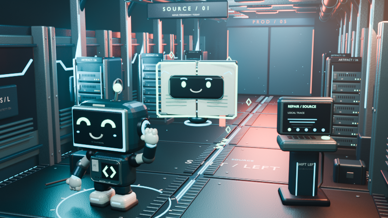

# SHIFT LEFT — Unreal Linux vertical slice

This is the native Unreal Engine 5.8 port of **The Leaked Secret**. It contains C++ gameplay source, an independently tested incident simulation, original Blender/FBX art, and scripts to import the assets, create a map and package Linux builds.

**Current verification:** the portable incident model passes 68 checks with GCC. The Unreal gameplay module, import automation, lighting, input, audio and packaging have not run in Unreal yet. This workspace has no Unreal Editor and only a 32 GB filesystem. There is no downloadable native executable yet.

The browser checkpoint remains in the parent project. Its full campaign and live text DOC are separate from this native slice.



*Blender look development using the exported models. This is not an Unreal gameplay screenshot.*

## Install Unreal on Linux

Use an x86-64 Linux development computer with a Vulkan-capable GPU. Epic recommends 32 GB RAM and at least 8 GB graphics memory; check the [current Linux development requirements](https://dev.epicgames.com/documentation/unreal-engine/linux-development-requirements-for-unreal-engine). Reserve substantial free disk space for the engine, project, shader cache and packaged build; a 32 GB system drive is insufficient.

1. Sign into your Epic account at the [official Linux download page](https://www.unrealengine.com/en-US/linux), accept the license yourself, and download the precompiled Unreal Engine 5.8 Linux archive. This route does not require the Windows Epic Games Launcher or building the entire engine from GitHub.
2. Extract it into a directory you own, such as `~/Unreal/UE_5.8`. The commands below assume that directory directly contains `Engine/`.
3. Install Git, Python 3 and a C++ compiler through your distribution. On Ubuntu: `sudo apt install git python3 build-essential`. Unreal's Linux archive supplies its own compatible engine compiler/toolchain; the system compiler runs the portable model checks.
4. Launch the editor once and let its initial setup finish:

```bash
"$HOME/Unreal/UE_5.8/Engine/Binaries/Linux/UnrealEditor"
```

Epic's [Linux quickstart](https://dev.epicgames.com/documentation/unreal-engine/linux-development-quickstart-for-unreal-engine) covers graphics drivers and editor troubleshooting. If Vulkan fails, fix the GPU/driver setup before trying the game. `-NullRHI` can import assets without a display; it cannot prove the game renders correctly.

## Get this branch without merging

This checkpoint is currently saved locally on `feat/unreal-linux-slice`; remote publication has not completed. Use the current workspace checkout now. The fetch/clone commands below apply after the branch is published.

From an existing clone, save any local work before switching branches:

```bash
git fetch origin
git switch --track origin/feat/unreal-linux-slice
cd unreal
```

For a fresh clone:

```bash
git clone --branch feat/unreal-linux-slice https://github.com/JustLikeFrank3/Shift-Left.git
cd Shift-Left/unreal
```

## Build and open the slice

Run from this `unreal/` directory:

```bash
./scripts/check-linux.sh "$HOME/Unreal/UE_5.8"
./scripts/test-core.sh
python3 ./scripts/verify-source.py
./scripts/build-linux.sh "$HOME/Unreal/UE_5.8"
"$HOME/Unreal/UE_5.8/Engine/Binaries/Linux/UnrealEditor" "$PWD/ShiftLeft/ShiftLeft.uproject"
```

The build script first compiles `ShiftLeftEditor`, then runs the editor's Python bootstrap. The bootstrap imports the FBX meshes and music, creates their materials and saves `/Game/Maps/DeliveryGrid`. Generated `.uasset` and `.umap` files require Unreal; they are not counterfeit text placeholders. Inspect the generated map, then press **Play**. Generated content is reproducible from the source assets and bootstrap.

The scripts stop on missing prerequisites or a failed import. Their presence does not establish that this project builds: the first actual Unreal compile can reveal API, import, shader or runtime issues that the portable checks cannot catch. If it fails, keep the compiler/import log so that those errors can be fixed.

The source preflight checks the original FBX headers, stereo WAV format, native input mappings, module targets and dynamically loaded content's cook paths. It does not invoke Unreal. A fresh completion marker also prevents the build script from reporting success when editor Python stops before saving the map.

## How play is intended to work

PATCH begins beside the live production leak, with DOC floating nearby. The corridor runs left to right through SOURCE, BUILD, TEST, STAGE and PROD. Walk and jump along the deck; the camera follows PATCH. Walk up to a terminal and press E to investigate or contain the leak. Press F nearby to open **PATCH!** and choose a credential route. Travel left to make structural repairs cheaper.

| Control | Action |
| --- | --- |
| A / D or ← / → | Walk along the corridor |
| Space | Jump |
| E | Connect to the nearby terminal |
| F | Open PATCH! at the nearby terminal |
| Q | Open DOC's offline guide |
| R | Validate the incident |
| M | Toggle the original score |
| 1 / 2 / 3 or mouse | Choose an operation in a panel |
| Escape | Close a panel or open help |

The first panel explains the controls. Standard mode has a three-minute active exposure window; guided mode removes time-based failure. Reading terminal/help/DOC panels pauses that window. Revoking an exposed credential is free and stops its exploitation, so containment is accessible before longer investigation. Wrong routes can re-expose the replacement. Repairs draw from 24 effort; free investigation and containment never require leftward travel. Retry starts a fresh incident if pressure or poor spending makes the run unsalvageable.

The source campaign JSON is included as reference data. **Only The Leaked Secret has native gameplay.** DOC is initially a local explanatory panel; the public ElevenLabs live text agent remains available in the browser implementation and has not been connected to native UI. The score is the existing original _Signal in the Dark_ candidate, not a newly approved soundtrack. Audio provenance is in [the parent audio notes](../public/audio/README.md).

## Package for Linux

After the editor build, import and in-editor playtest succeed:

```bash
./scripts/package-linux.sh "$HOME/Unreal/UE_5.8"
```

The archive goes to `unreal/build/Linux/` by default. Test the resulting launcher from a terminal on the intended Linux hardware before sharing it. Packaging is currently unverified. A Linux package does not produce Windows or macOS executables.

## Source and verification

- `ShiftLeft/Source/ShiftLeft/Simulation/IncidentModel.h`: dependency-free C++17 simulation. Tests cover containment, replacement lifecycle, budget atomicity, wrong-route recovery, paused time, deterministic replay, grading and blind policies that fail.
- `ShiftLeft/Source/ShiftLeft/`: native character, corridor, game mode and HUD adapters. These require Unreal headers and generated reflection code to compile.
- `ArtSource/`: original Blender source and asset-generation script. Previews are labeled **Blender look development**, not Unreal screenshots.
- `ShiftLeft/Content/ArtSource/`: FBX geometry consumed by the editor bootstrap.
- `scripts/bootstrap_editor.py`: Unreal-only asset/material/map import.

Before calling this a playable native release, verify compilation; FBX size, pivot and facing; readable camera and characters; collision/jumping and terminal reach; all repair/retry paths; mouse and keyboard focus; music and mute; exposure pausing; Lumen/performance on the target GPU; and a packaged Linux launch. Model tests and Blender previews do not substitute for those checks.
